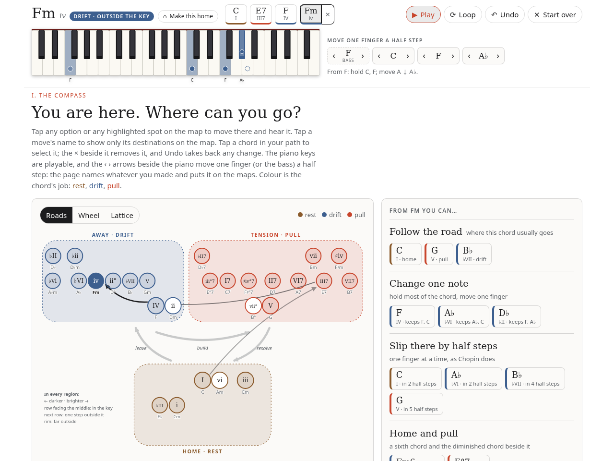
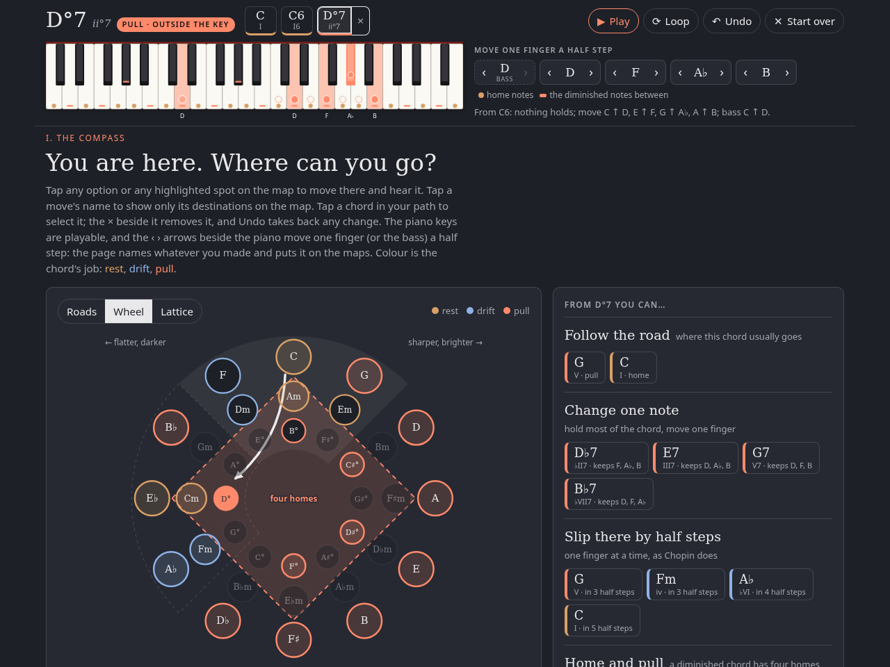

# Chord Landscape

An interactive map of harmony for improvisers. You are on a chord: where can you go from here?

**Try it: <https://stefanom.github.io/chord-landscape/>**



Every chord has a job in the key: it **rests**, it **drifts** away, or it **pulls** back. Pick a home key, tap a
chord, and the page shows where you are, what the chord wants, and the moves you can make from it. Everything you
do is drawn on three maps and on a piano, and everything makes a sound.

It was built for a specific problem: sitting at the piano, improvising, and not knowing which chord to try next.

## What is in it

**Moves.** From the chord you are on, the page lists the ways out, each with the chords it leads to:

| Move | What it is |
|---|---|
| Follow the road | where this chord usually goes |
| Change one note | hold most of the chord, move one finger |
| Slip there by half steps | reach a chord one finger and one half step at a time, as Chopin does |
| Home and pull | a sixth chord and the diminished chord beside it (Barry Harris's eight-note scale) |
| Borrow | chords from the minor side of the same key, or the major side |
| Aim at a chord | play the dominant of where you want to land |
| Slide a half step | tritone substitutes, passing diminished chords, the whole shape shifted |
| Leap a third | the same chord shape a third away |
| Mirror it | the negative-harmony twin |

**Voices.** Beside the piano, every note of the chord has arrows that move it a half step. The page names whatever
you made and puts it on the maps. Harmony as moving voices, not as a list of chords.

**Three maps of the same place.**

- *Roads*: three regions for the three jobs, Home, Away and Tension. Inside each, darker chords sit on the left and
  brighter ones on the right; chords outside the key sit further from the centre.
- *Wheel*: the circle of fifths with home at the top.
- *Lattice*: the tonnetz. Every triangle is a triad, and triangles that share an edge share two notes.

**The shape of what you played.** The *weave* shows how each voice moves from chord to chord. The *profile* shows
how far each chord sits from rest, so you can see whether a progression builds and releases or only circles.

**Somewhere to start.** Twelve well-known progressions to load and bend, a generator that wanders away from home
and back, and a deck of practice dares, some of which set themselves up.



## Run it

Nothing to install: the app is static HTML, CSS and JavaScript with no dependencies.

- **Online:** the link above.
- **From a clone:** `python3 -m http.server` in the repository, then open <http://localhost:8000>.
- **Straight from disk:** open `index.html`. Everything works, but the piano is a small synth, because a page
  opened from disk cannot fetch the recordings.
- **As one file:** `python3 tools/build.py` writes `dist/chord-landscape.html`, a single self-contained file with the
  recordings inside it. It needs no server and no network.

## How it thinks

The rules that decide a chord's job, where it sits on each map, and which moves are offered are written down in
[docs/model.md](docs/model.md). They are rules of thumb from functional harmony, chosen to be useful at the
keyboard. They are not measured from a corpus and they are not laws: if a move sounds good, it is good.

## Layout

```
index.html          the page
css/style.css       the look; the three job colours are --rest, --drift and --pull
js/theory.js        chords, names, numerals, jobs, and the moves out of a chord
js/voicing.js       how a chord is laid out on the keys
js/voices.js        one finger a half step, slipping by half steps, the sixth-diminished walk
js/sound.js         the piano
js/path.js          the path you build: cursor, playback, undo
js/header.js        the bar that stays on screen: chord, path, piano
js/maps.js          Roads, Wheel, Lattice
js/shape.js         the weave and the profile
js/compass.js       the list of moves
js/practice.js      known progressions, drills, dares
js/theme.js         light and dark
js/main.js          drawing, wiring, start-up
assets/piano/       the piano recordings (see Credits)
tools/build.py      makes the single-file version
tests/unit/         the harmony logic, run in Node
tests/e2e/          the page, run in a real browser
```

The scripts are plain files that share one scope, loaded in the order `index.html` lists them. There is no
bundler, no framework and no build step for development.

## Development

```
make serve     # http://localhost:8000
make unit      # node --test tests/unit/*.test.mjs
make e2e       # python3 -m pytest
make test      # both
make build     # dist/chord-landscape.html
```

The unit tests need Node 20 or later. The browser tests need Python 3.9 or later:

```
pip install -r requirements-dev.txt
python3 -m playwright install chromium
```

They run against both ways the app ships: served over http, and as the single built file. See
[CONTRIBUTING.md](CONTRIBUTING.md).

## Credits

- **Piano:** sixteen notes of the [Salamander Grand Piano](https://github.com/sfzinstruments/SalamanderGrandPiano)
  by Alexander Holm, licensed [CC BY 3.0](https://creativecommons.org/licenses/by/3.0/), shortened and re-encoded.
  See [assets/piano/README.md](assets/piano/README.md).
- **Home and pull** follows Barry Harris's sixth-diminished teaching, as told in Joe Mendick's video
  [The Major Chord Has Been Missing a Note](https://www.youtube.com/watch?v=OMdj6rMhphc).
- **Voices** follows the reading of Chopin's E minor Prelude in Inside the Score's video
  [Most musicians learn harmony wrong](https://www.youtube.com/watch?v=SJYj57TUKjc).
- **Mirror it** is Ernst Levy's polarity, better known today as negative harmony.

## License

The code is under the [MIT License](LICENSE). The piano recordings in `assets/piano/` are not: they are
CC BY 3.0, as above.
